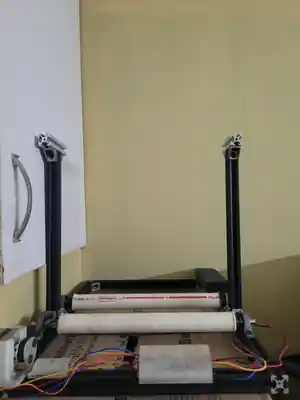
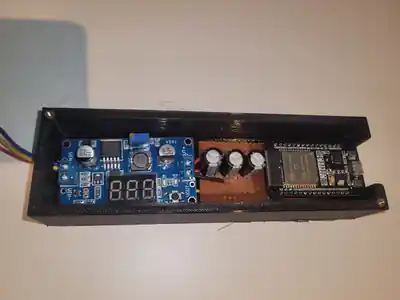
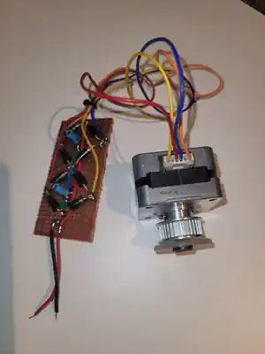
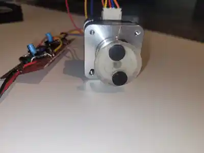

# Hardware and Mechanical Prototype

This document records what can be seen in the prototype photographs and the information needed to make a future rebuild repeatable. Photographs are visual references, not dimensioned drawings or verified circuit diagrams.

## Hardware blocks

### Roller trainer frame

The current mechanical prototype uses extrusion profiles, two cylindrical rollers and end supports/brackets. Record frame dimensions, roller spacing, shaft diameters, bearings, materials, wheel-to-roller coupling and fasteners from physical measurements.

### ESP32 and power electronics enclosure

The enclosure photo shows an ESP32 development board, a perfboard section and an adjustable DC-DC converter with a display. The exact converter model and configured voltage are not established by the photograph. Measure supply input/output voltage and current limits before documenting or reconnecting final power wiring.

### Magnetic rotation test rig

The rig shows a motor, rotating disc/pulley with two visible dark markers and a discrete-component circuit. Verify whether the markers are magnets and confirm the actual sensor output before setting pulses per revolution. Do not infer a pinout or circuit topology from these photographs.

## Measurements to record

- ESP32 board variant and GPIO pin mapping.
- Exact Hall-effect sensor part number, supply voltage, output type and signal conditioning.
- Verified sensor pulses per revolution and the firmware constant used.
- Effective wheel/roller diameter, drive ratio and speed calibration procedure.
- Power-source voltage/current ratings, regulator settings, fuse/current limit and ground arrangement.
- Frame dimensions, roller spacing, shaft/bearing details, materials, fasteners and coupling method.
- A verified schematic, pin-to-pin wiring diagram, bill of materials and photos of the final assembled hardware.

## Calibration procedure

1. Inspect the assembly and confirm the sensor is mounted securely with suitable clearance.
2. Measure one full shaft revolution by hand and count the actual digital sensor pulses.
3. Confirm the sensor does not produce false pulses while stationary.
4. Compare firmware RPM against a known rotation rate; record the method and error.
5. Calibrate estimated speed using the measured effective rolling circumference and any drive ratio.
6. Test BLE telemetry with the roller turning slowly before conducting a longer ride.
7. Record configuration, date, firmware revision and results in the test plan.

## Safety and provenance

Secure the frame and rotating parts before powered tests. Keep wiring away from rollers and shafts; verify power polarity and regulator output before connecting electronics. Record exact parts and sources, and document licensing/provenance for externally sourced CAD and electronic designs.
